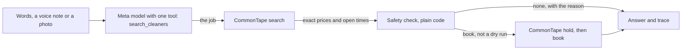

# CommonTape Muse Agent

Ask Meta's AI for a cleaner, get a real booking.

Live demo: https://commontape-muse-agent.vercel.app

A person types, speaks or photographs a cleaning job. A Muse-powered agent
works out the job, finds local cleaning businesses that can do it, gets the
exact price the business set, checks the booking in plain code before it
makes it, and books a slot. Every model and tool call is shown, in order.

Built for the [Meta Global AI Developer Hackathon](https://cerebralvalley.ai/e/meta-ai-developer-hackathon),
26 Oct – 4 Nov 2026, startup track, theme "Build for Your World".
MIT licence.

## Try it

Open the live demo on a phone or a laptop and:

1. Tap **Example: a standard clean**, or type *I need a standard clean for
   my 2-bedroom, 1-bathroom apartment in ZIP 10001, any morning next week*,
   and press **Find a cleaner**. The agent comes back with the business,
   CommonTape's price and a morning next week.
2. Tap **Example: a $40 budget**. The agent refuses, and says why in
   CommonTape's own words.
3. **Record a voice note** or **Add a photo** of a room instead of typing.
   A photo shows the room, not what kind of home it is, so the agent asks;
   one tap on **Apartment**, **Studio**, **House**, **Condo** or
   **Townhouse** sends the same request again with that added.
4. After a request, press **Book this**, then **Use sample details** and
   **Book it**. That books the slot for real, at a pretend business (below),
   and shows the booking. **Cancel this booking** cancels it at CommonTape,
   and the page shows CommonTape's own status for it afterwards.

On the page, every request is a dry run until **Book it** is pressed, and a
dry run never holds or books anything. Bookings go only to "CommonTape Demo
Cleaning", a pretend business in ZIP 10001 that CommonTape runs for anyone
to test with. Its jobs are deleted after about a day, and no real cleaner is
ever booked from this page.

## What is new in this hackathon

Everything in this repository was written during the hackathon, starting
26 Oct 2026. The commit history is the record of it.

| New, built in the hackathon (this repository) | Existed before (not in this repository) |
|---|---|
| The agent: request to job to search to safety check to booking | [CommonTape](https://commontape.com), a live service where small cleaning businesses publish their prices, service area and open times so AI agents can book them |
| The Meta model wiring: Muse Spark, Muse Voice Transcribe, Muse Spark Open | CommonTape's public agent connection (search, hold, book, cancel) and its published demo key |
| The safety check, the time budget and the polite limit | The pretend business "CommonTape Demo Cleaning" |
| The page: typing, voice recording, photos, the trace, Book this, Cancel this booking | |
| The tests, the voice-note fixture and the checks in `scripts/` | |

CommonTape is a separate, private product built before the hackathon. This
agent talks to it only through its public agent connection, the same one
any AI assistant uses. No CommonTape code is copied here.

## Meta models used

Through the Meta Model API (`https://api.meta.ai/v1`):

- `muse-spark-1.3`: the agent itself. It turns a request, or a photo of the
  home, into a job with one tool call, which becomes the CommonTape search.
- `muse-voice-transcribe-1.0`: turns a voice note into text.

Or, where the Meta Model API is not open to the builder, Meta's open-weights
model served by Baseten (`https://inference.baseten.co/v1`):

- `meta-models/muse-spark-open` (Muse Spark Open): the same agent,
  with the same tool. It hears the voice note itself, writes down what was
  said, and reads photos of the home.

The trace names whichever model answered, so it always shows which one ran.

## How it works



1. **Hear and see.** A voice note goes to Muse Voice Transcribe, or straight
   to Muse Spark Open, which hears it in the same call. Now and then Muse
   Spark Open hears a voice note without its ZIP, so then it is asked once
   more, and the trace shows both listens. A photo goes to the model as an
   image.
2. **Understand.** The model answers with one tool call, `search_cleaners`:
   the ZIP, the kind of clean, the home (type, bedrooms, bathrooms), the
   budget, the times asked for, and what it heard or saw.
3. **Search.** That job, exactly as the model gave it, becomes a CommonTape
   search. CommonTape answers with each business's own price for that job
   and its open times, or with the reason a business does not fit.
4. **Check.** The safety check (`lib/plan.js`) decides, in code rather than
   in the model, whether anything may be booked.
5. **Book.** Only when the check says book and it is not a dry run: one hold,
   then one book. If the book fails, the hold is given back at once.

The agent's endpoint, `POST /api/agent`, takes `text`, `audio_base64` or
`image_base64`, plus `dry_run`. The answer always has the same shape:

| Field | What it holds |
|---|---|
| `transcript` | the voice note as text, when there was one |
| `job` | the job the agent understood, as a CommonTape search |
| `options` | businesses that can do it, each with CommonTape's exact price and a time |
| `plan` | `book` or `none`, with the reason in plain words |
| `trace` | every model and tool call, in order |
| `booked` | the booking, when one was made |

`POST /api/cancel` takes a booking's `transaction_id`, cancels it at
CommonTape (pressing it twice is still one cancel) and reads CommonTape's
status for it back.

### The safety check

A model that gets the job wrong can never book something that was not asked
for, because the last word is plain code:

- Only a request the model says is about cleaning a home goes on, and it
  needs a 5-digit ZIP.
- An option counts only if it is the service asked for, at CommonTape's own
  price in dollars, within the budget, at an open time still ahead. Times
  like "a morning next week" are matched in the business's own time zone.
- The cheapest option that fits wins, then the soonest. The agent never
  makes up or changes a price.
- A real booking needs a name, a phone number and an address in the same
  ZIP as the search.
- **Book this** names the option the person saw. If the business, time or
  price changed since, nothing is booked and the answer says what it is now.
- Each request makes at most one hold and one book, keyed by the request
  itself, so sending the same request again never books twice.
- Anything but `"dry_run": false` is a dry run, and a dry run's CommonTape
  connection cannot hold or book even by mistake.

### Limits

The demo key is shared by everyone trying CommonTape (30 calls a minute), so
each person can ask the agent 12 times a minute and the whole site 25 times;
past that it answers 429 with how long to wait, before CommonTape is asked.
Every request finishes inside the host's 60 seconds: the model gets one try
with the time that is left after CommonTape's steps, a CommonTape search is
cut off at 15 seconds (it takes about 1.5, and now and then about 12) and a
hold or a booking at 8, and no hold or booking is started without the time to
finish it or give it back.

## For the judges

**Impact.** Many small cleaning businesses still take bookings by phone and
text, so an AI assistant cannot book them. CommonTape lets them be booked by
any AI agent at their own prices; this agent is the customer's side of that.
A person says what they need, in their own words or with a photo, and gets a
real, priced slot, or a plain reason why not.

**Use of Meta AI tooling.** Muse Spark does the reasoning and the one tool
call that becomes the search, and reads photos. Muse Voice Transcribe turns
voice notes into text, with keywords for ZIP codes and room counts. Muse
Spark Open on Baseten hears the voice note itself. With a Meta model
connected, it is the only thing that turns a request into a job, and the
trace shows which one ran.

**Technical depth.** The model's job goes to CommonTape exactly as given, and
the safety check stands between it and any booking. Writes are idempotent,
so a repeat never books twice, and a failed book gives its hold back. Every
request runs on a time budget inside the host's limit, and a polite limit
protects the shared demo key. `npm test` runs every test with no network;
`scripts/page-check.mjs` drives the page in headless Chrome at phone width
with a fake microphone; `scripts/judge.mjs` checks an answer's business and
price against CommonTape's own search.

**Demo.** The live page works at phone width: type, record a voice note in
the browser, or add a photo, then see the options, the plan, the reason and
the full trace, and book the pretend business for real.

## Run it locally

Needs Node 24 or newer.

```sh
npm install
npm test
npm run dev         # http://localhost:3000
npm run ct-search   # read-only: searches CommonTape's demo business, never holds or books
```

To check one answer against CommonTape's own search, with a Meta model
connected (the stand-in fails this check on purpose, because no Muse model
ran):

```sh
curl -s localhost:3000/api/agent -H 'content-type: application/json' \
  -d '{"text":"Standard clean for my 2-bedroom, 1-bathroom apartment in ZIP 10001"}' \
  | node scripts/judge.mjs typed
```

Settings go in `.env.local` (copy `.env.example`); on Vercel they live in the
project's settings. Never commit a key.

| Setting | What it does |
|---|---|
| `MODEL_API_KEY` | a Meta Model API key: turns on Muse Spark and Muse Voice Transcribe |
| `BASETEN_API_KEY` | a Baseten key: turns on Muse Spark Open when there is no Meta key |
| `MODEL_MODE` | `muse`, `open` or `stub`; left empty, it follows the keys that are set |
| `MODEL_BASE_URL`, `MODEL_ID`, `ASR_MODEL`, `OPEN_BASE_URL`, `OPEN_MODEL_ID` | where each model is and which one, with the defaults in `.env.example` |

With no key at all, a stand-in that follows simple rules reads typed
requests. It names itself `stub-no-key` in the trace, so it is never mistaken
for Muse, and the page says so at the top.

The CommonTape connection (`lib/commontape.js`) uses the demo key that
CommonTape publishes on its [docs page](https://commontape.com/docs). That
key reaches only the pretend business, so running this agent never books a
real cleaner.

The sample voice note in `fixtures/` is made by `scripts/make-voice-note.sh`
with eSpeak NG's own voice, which anyone may use (the macOS voices are for
personal, non-commercial use only). The sample home photo,
`fixtures/home-photo.jpg`, is "Interior Living" by Jarosław Ceborski, from
[StockSnap](https://stocksnap.io/photo/interior-living-6SMA09U7Y8) under the
CC0 licence (no rights reserved), at 960 pixels wide with its metadata
removed.

## Where things are

| Path | What it is |
|---|---|
| `api/agent.js`, `api/cancel.js` | the endpoints, as Vercel functions |
| `lib/agent.js` | the agent's steps and the trace |
| `lib/model.js` | the Meta models, the `search_cleaners` tool, and the stand-in |
| `lib/plan.js` | the safety check |
| `lib/commontape.js`, `lib/job.js` | CommonTape's public agent connection, and the job as a search |
| `lib/handler.js`, `lib/throttle.js` | request checks, the status answer, and the polite limit |
| `public/` | the page |
| `scripts/`, `test/`, `fixtures/` | checks, tests and the sample voice note |

## Status

As of 26 Oct 2026:

- **Live on Meta's model:** the live demo runs on Muse Spark Open, served by
  Baseten. A typed request comes back in about 6 seconds and a voice note in
  about 10, each with the right job and CommonTape's exact price, and the
  model hears the voice note itself and writes down what was said. With a
  photo, it describes the room; it does not guess what kind of home it is,
  so the words say it, or the page asks with one-tap buttons.
- **Live bookings:** on 26 Oct a live test booked the pretend business five
  times through this site, with no wrong booking and no duplicate, and
  cancelled every one. That ran on the stand-in model, before Muse was
  connected.
- **Built, not yet run live:** Muse Spark and Muse Voice Transcribe through
  the Meta Model API. Meta's developer console is not open in the builder's
  country, so the live demo uses Muse Spark Open.
- **Still to come:** the video.

## Licence

MIT. See [LICENSE](LICENSE).
